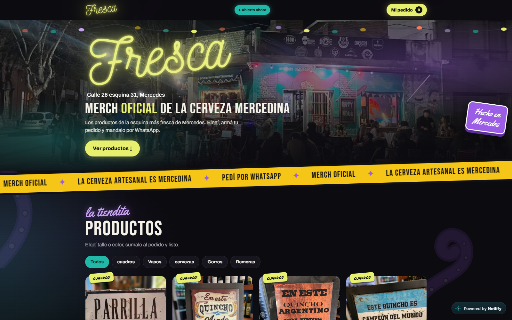
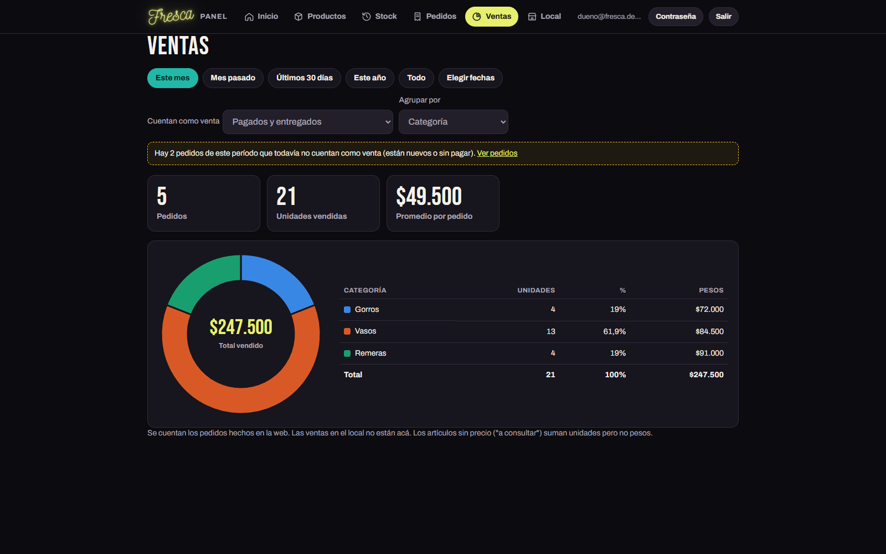
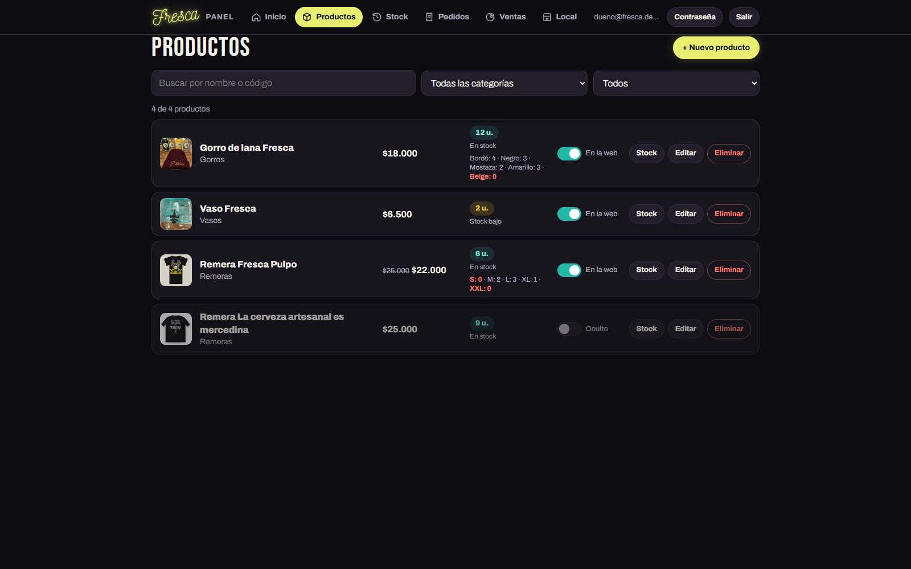
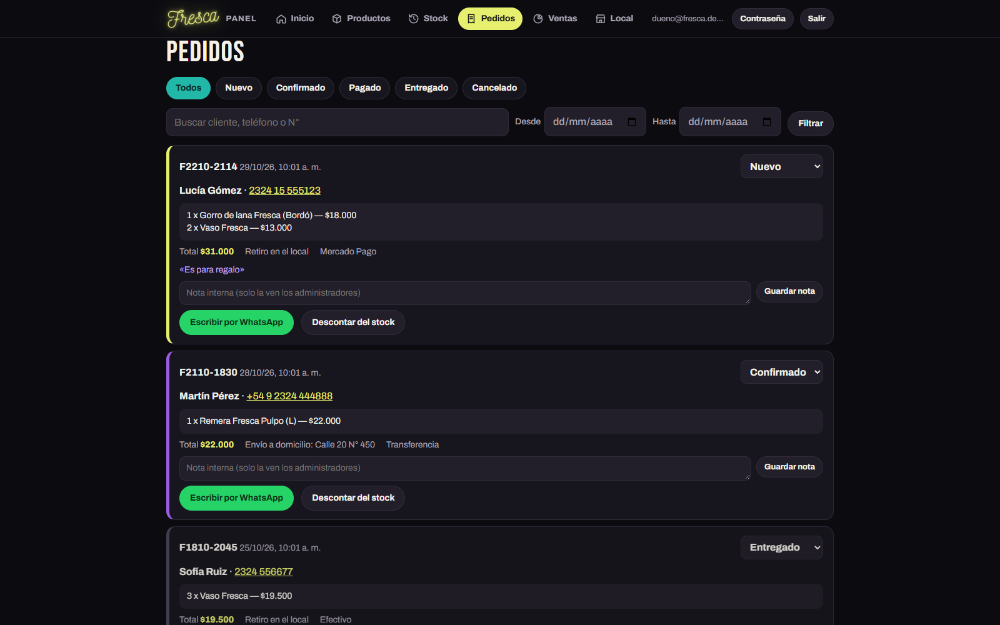

# Fresca · tienda de merch + panel de administración

Tienda online para **Fresca**, almacén de cerveza artesanal de Mercedes (Buenos Aires), con un panel propio para que el dueño maneje productos, stock, pedidos y horarios sin tocar código.

**Sitio en vivo:** https://fresca-merch.netlify.app




## Qué hace

**Tienda (cliente)**
- Catálogo con filtros por categoría, talles y colores, precio de promoción tachado.
- Vista grande de cada producto con varias fotos (una por color) y dirección propia (`#producto/...`).
- Carrito y pedido que se envía por WhatsApp; opción de pago con Mercado Pago.
- Cartel de abierto/cerrado según los horarios cargados en el panel, mapa del local.
- Talles sin stock deshabilitados automáticamente.

**Panel de administración (`/admin`)**
- Ingreso con cuenta de administrador, recuperación de contraseña y cierre por inactividad.
- Alta y edición de productos con fotos (se achican y convierten en el navegador).
- Stock por producto y por talle/color, historial de movimientos y alertas de stock bajo.
- Pedidos con estados, notas internas y descuento de stock al entregar (todo o nada).
- Ventas por período con gráfico por categoría o producto.
- Horarios de atención, estado del local y aviso; la tienda se actualiza al guardar.




## Cómo está hecho

| Parte | Tecnología |
|---|---|
| Tienda | HTML, CSS y JavaScript sin frameworks, publicada en Netlify |
| Panel | JavaScript con módulos ES y `supabase-js` |
| Base de datos, login y fotos | Supabase (PostgreSQL con Row Level Security, Auth y Storage) |
| Intermediario | Google Apps Script: entrega productos con caché y recibe pedidos (con copia en Google Sheets) |

Decisiones de seguridad:
- Todas las reglas de acceso están en la base (RLS y funciones `SECURITY DEFINER`); el navegador solo tiene la clave pública.
- La clave secreta vive únicamente en las propiedades del Apps Script, nunca en el repositorio.
- Cabeceras de seguridad (CSP, `X-Frame-Options`, `noindex` en el panel) en `_headers`.

## Estructura

```
index.html            tienda
admin/                panel (app.js, api.js, demo.js, admin.css)
supabase/schema.sql   tablas, permisos y funciones (se puede ejecutar más de una vez)
apps-script/          código del Google Apps Script
fotos/                imágenes de la tienda
_headers              cabeceras de seguridad para Netlify
LEEME-panel.md        guía de instalación y uso
```

## Probarlo

El panel tiene un **modo demo** con datos inventados que no se guardan. Sirviendo la carpeta en local:

```bash
npx serve .
```

y abriendo `http://localhost:3000/admin/?demo` (ingresa con cualquier correo y contraseña).

La instalación completa (Supabase, Apps Script y Netlify) está en [LEEME-panel.md](LEEME-panel.md).

---
Diseño, desarrollo e implementación: Martín Bandoni.
Marca, logo y fotos pertenecen a Fresca y se muestran con su permiso.
